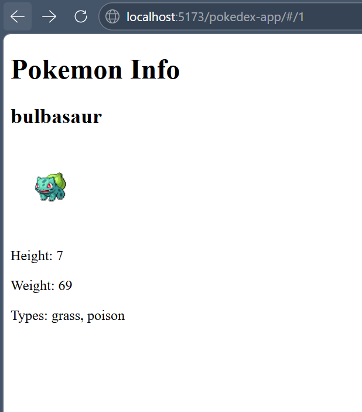
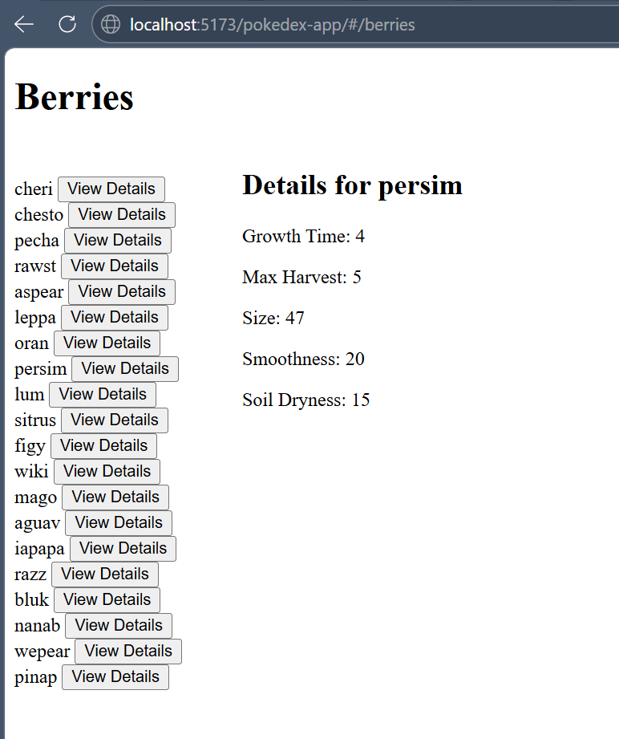

# Rajapinnat ja julkaisu

Näissä tehtävissä harjoitellaan ulkoisen rajapinnan käyttöä sovelluksessa ja erityisesti niiden dokumentaatioiden tulkitsemista sekä sovelluksen julkaisua github pages-palvelussa. Tehtäviin liittyvä esimerkkisovellus löytyy githubista https://github.com/2026-ohjelmistokehittajana-toimiminen/catfact-app

Esimerkkisovellus on julkaistu osoitteeseen https://2026-ohjelmistokehittajana-toimiminen.github.io/catfact-app/

## Tehtävät

### Tehtävä 1

Tutustu projektista valmiiksi löytyvään koodiin sekä pokeapin dokumentaatioon https://pokeapi.co/docs/v2

Kannattaa kiinnittää huomiota ainakin näihin:
  - Miten sovellus hakee pokemonien tiedot
  - Missä muodossa API-palauttaa datan/mitä se sisältää
  - Mitä eri tiedostoissa tehdään

### Tehtävä 2

Tällä hetkellä sivulla listattujen pokemonien nimi ja kuva toimivat linkkinä reittiin/routeen, jossa on tarkoitus näyttää valitusta pokemonista tarkempia tietoja.

1. Lisää */services/pokemon* -tiedostoon uusi funktio **getPokemonById**, joka ottaa yhden parametrin *id*, ja tekee pokemonApiin kutsun, jolla haetaan *id*:tä vastaavan pokemonin tiedot
   - selvitä dokumentaatiosta, mikä endpoint palauttaa nämä tiedot eli mihin osoitteeseen tulee lähettää get-pyyntö
2. Lisää */pages/PokemonInfo* -tiedostoon seuraavat asiat:
   1. Tila *pokemon*, jonka arvo on aluksi *null*
   2. */services/pokemon* -tiedoston importtaus
   3. Hae *id*: perusteella pokemonin tiedot käyttäen *useEffectia* ja */services/pokemon* -tiedoston **getPokemonById**-funktiota. Tallenna tiedot tilaan *pokemon*
   4. Muuta koodia siten, että näytät pokemonin nimen, kuvan (tavallinen muoto edestä), pituuden, painon ja tyypin. Alla esimerkki kuva, miltä sivu voisi näyttää
    
    
3. Lisää PokemonInfo näkymään vielä nappi, jolla pääsee navigoimaan takaisin pääsivulle
   * Tarvitset *useNavigate*-hookia

Bonus: lisää pokemon info näkymään myös kuva pokemonin shiny versiosta

### Tehtävä 3

Seuraavaksi toteutetaan uusi näkymä polkuun **/berries**, jossa pystyy selaamaan marjojen tietoja. Tehtävän jälkeen näkymä voi näyttää esimerkiksi tältä:

  

1. Aloita lisäämällä */services/pokemon* -tiedostoon uusi funktio **getBerries**, joka tekee API-pyynnön osoitteeseen, joka palauttaa listan kaikista marjoista. Käytä tiedostosta löytyvää mapResults-funktiota samaan tapaan kuin **getPokemons**-funktiossa.
2. Lisää sitten myös funtio **getBerryById**, joka hakee id:n perusteella yhden marjan tiedot API:sta
3. Lisää *pages*-kansioon uusi tiedosto **Berries.jsx**. Lisää tiedostoon komponentti **Berries**, joka renderöi h1-elementissä tekstin **Berries**
4. Lisää **App.jsx**-tiedostoon uusi Route, joka renderöi äsken tekemäsi **Berries**-komponentin polussa */berries*
5. Toteuta nyt **Berries**-komponenttiin seuraavat asiat:
   1. Hae lista kaikista marjoista **getBerries**-funktion ja **useEffect**-avulla, kun komponentti renderöidään ensimmäisen kerran. Määrittele komponentille tila **berries**, johon tallennat listan.
   2. Renderöi Kaikkien listan marjojen nimet sivulla
   3. Lisää komponenttiin tilat **selectedBerry** ja **berryDetails** anna kummankin alkuarvoksi *null*
   4. Renderöi, jokaisen marjan nimen viereen nappi, joka asettaa **selectedBerry**-tilan arvoksi kyseisen marjan id:n
   5. Käytä **getBerryById**-funktiota ja **useEffect**-hookia siihen, että haet **selectedBerry**-tilaan tallennettua id:tä vastaavan marjan tiedot. Tallennatta nämä tiedot **berryDetails**-tilaan.
   6. Toteuta yksittäisen marjan tietojen ehdollinen renderöinti siten, että kun käyttäjä on valinnut marjan ja sen tiedot on haettu API:sta, renderöi marjalistan viereen valitun marjan nimi, growth time, max harvest, size, smoothness ja soil dryness tiedot.

Bonus: Renderöi myös marjan kuva. Kuvan (eli spriten) osoitetta ei löydy suoraan marjan tiedoista. Berry:llä on kenttä item, josta löytyy item-endpointin osoite. Itemista löytyy linkki kuvaan.

### Tehtävä 4

Paranna sovelluksesi ulkoasua käyttämällä haluamaasi tyyli- tai komponenttikirjastoja. Voit parannella myös sovelluksen käytettävyyttä lisäämällä esimerkiksi navigaatiopalkin sivun yläosaan.

Voit katsoa inspiraatiota täältä: https://2026-ohjelmistokehittajana-toimiminen.github.io/pokedex-esimerkki/

### Tehtävä 5

Julkaise sovelluksesi github pages-palvelun avulla. Tee julkaisu käyttämällä github actionsia. Moodlen materiaaleista löytyy tarkempia ohjeita.

### Bonustehtävä 5

Lisää mahdollisuus katsoa minkä tahansa pokemonin tietoja siten, että käyttäjä syöttää haluamansa pokemonin id:n input-kentän kautta.

### Bonustehtävä 6

Jatka pokemon sovelluksen kehitystä tai etsi jokin muu kiinnostava avoin API ja toteuta sitä hyödyntävä muu sovellus.
